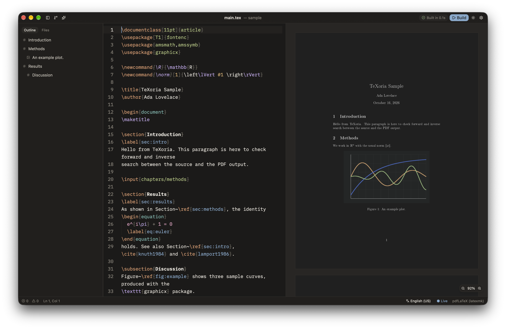

# TeXoria

An elegant, fast LaTeX editor written in Rust with
[GPUI](https://www.gpui.rs) (Zed's GPU-accelerated UI framework) for macOS, Windows and Linux.

| Paper | Ink |
|---|---|
|  |  |

- **Live preview**: the document recompiles as you type, without blocking the UI.
  The new PDF replaces the old one only once it is rasterized, so the preview never flashes.
- **Two-way SyncTeX**: ⌘J (Ctrl+J) jumps from the cursor to the PDF; ⌘-click or
  double-click in the PDF jumps back to the source line.
- **Errors and warnings** underlined in the editor and collected in the *Problems* panel.
- **Completion** for commands, environments (with automatic `\end{}`), `\ref` from the
  project's labels, `\cite` from `.bib` files (also matches title and author) and `\usepackage`.
- **Outline** across multi-file projects (`\input`/`\include`), highlighting the current section.
- **Hybrid engine**: uses TeX Live or MiKTeX when installed (through latexmk: pdfLaTeX, XeLaTeX,
  LuaLaTeX), otherwise the bundled Tectonic. A runaway compile stops after 5 minutes
  (`compile_timeout_secs` in the settings), or right away with ⌘. (Ctrl+.).
- **Git built in** (⇧⌘G / Ctrl+Shift+G): see what changed with word-level diffs (unified or side by
  side), stage, commit (⌘↵ in the message box), amend, pull, push and fetch, browse the history
  and restore any file from an older commit, switch or create branches, resolve merge conflicts,
  and initialize or clone a repository (GitHub, GitLab, Overleaf…). It uses the `git` already on
  your system, so your credential helpers and SSH keys keep working.
- **Safe with untrusted projects**: a project's own `latexmkrc` (Perl, which can run any command)
  and its Git configuration (which can too) are ignored until you click *Trust Project*; your own
  system and user rc files still apply.
- **Paper** (light) and **Ink** (dark) themes; in dark mode the PDF is darkened while keeping its hues.

## Layout

| Crate | Role |
|---|---|
| `crates/texoria` | GPUI app: window, editor, panels, themes |
| `crates/tex-compile` | Engine discovery, background compile queue in isolated processes (debounce, cancellation) |
| `crates/tex-git` | Git through the system `git` CLI: status, diffs, commit, sync, history, branches |
| `crates/tex-log` | TeX log parser → diagnostics |
| `crates/synctex` | `.synctex(.gz)` reader, forward and inverse search |
| `crates/tex-syntax` | Tree-sitter grammar, highlight query, semantic index |
| `crates/tex-project` | Root file detection, include graph, `.bib` files |
| `crates/tex-complete` | Context-aware completion with fuzzy ranking |
| `crates/pdf-view` | PDF rasterization with PDFium on a dedicated thread |

Only `texoria` depends on the UI: every other crate is plain logic, testable without a window.

## Development

Requires stable Rust (edition 2024). On Linux, GPUI also needs:

```sh
sudo apt install gcc g++ clang libfontconfig-dev libwayland-dev libxkbcommon-x11-dev \
  libx11-xcb-dev libssl-dev libzstd-dev libasound2-dev libvulkan1
```

```sh
./scripts/fetch-pdfium.sh      # PDFium into vendor/pdfium (required for the preview)
./scripts/fetch-tectonic.sh    # Tectonic into vendor/tectonic (optional)
cargo run -p texoria -- path/to/document.tex
cargo test --workspace
cargo test -p tex-compile -- --include-ignored   # also exercises Tectonic (downloads TeX files on first run)
```

The editor typeface is IBM Plex Mono (SIL Open Font License), bundled in `crates/texoria/assets/fonts`
(refresh it with `scripts/fetch-fonts.sh`). Icons are from [Lucide](https://lucide.dev) (ISC).

### Packaging

```sh
cargo install cargo-packager --locked
cargo packager --release -p texoria   # .app/.dmg, NSIS, .deb, AppImage in target/dist
```
