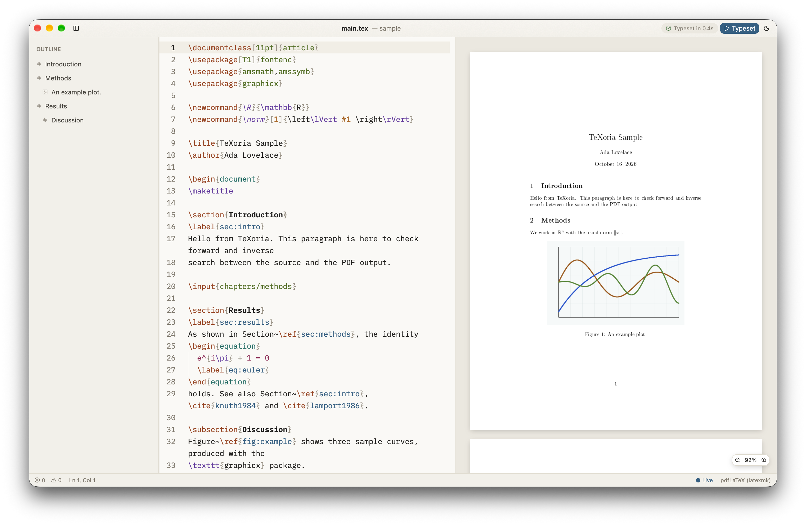

<div align="center">


# TeXoria

**Write LaTeX. See the PDF as you type.**

A fast, native LaTeX editor for macOS, Windows and Linux, written in Rust on
[GPUI](https://www.gpui.rs), the GPU-accelerated UI framework behind Zed.

[](https://github.com/Herbrant/TeXoria/actions/workflows/ci.yml)
[](https://github.com/Herbrant/TeXoria/releases/latest)
[](#installation)
[](LICENSE)

[**Download**](https://github.com/Herbrant/TeXoria/releases/latest) ·
[Documentation](docs/README.md) ·
[Contributing](CONTRIBUTING.md)

<br>

<picture>
  <source media="(prefers-color-scheme: dark)" srcset="assets/screenshot-ink.png">
  
</picture>

</div>

## Features

- **Live preview**: the PDF updates as you type, without ever blocking the editor.
- **Two-way SyncTeX**: jump from the source to the matching spot in the PDF, and back.
- **Works out of the box**: uses your TeX Live, MacTeX or MiKTeX through latexmk, or the bundled
  Tectonic when there is none.
- **Smart completion** for commands, environments, `\ref` labels, `\cite` keys and packages.
- **Outline, file browser and inline diagnostics** across multi-file projects.
- **Spell checking in ~90 languages**, detected automatically for each file.
- **Git built in**: diffs, commits, history, branches and merge conflicts, using your own `git`.
- **Overleaf, offline**: clone a project, work without a connection, *Sync* when you are back.
- **Coding agents**: Claude Code, Codex, Gemini CLI, Copilot and others write, rewrite and fix
  your document, and you review what they changed.
- **Safe by default**: a project's `latexmkrc` and Git configuration never run until you trust it.

## Installation

**macOS and Linux**, in one command:

```sh
curl -fsSL https://raw.githubusercontent.com/Herbrant/TeXoria/main/scripts/install.sh | sh
```

**Windows**: download and run the
[installer](https://github.com/Herbrant/TeXoria/releases/latest)
(`texoria-<version>-windows-x86_64-setup.exe`).

Or use a package manager:

| Platform | Command |
|---|---|
| macOS (Homebrew) | `brew tap herbrant/tap && brew trust --cask herbrant/tap/texoria && brew install --cask texoria` |
| Arch Linux (AUR) | `yay -S texoria-bin` |
| Debian, Ubuntu | `sudo apt install ./texoria_<version>_amd64.deb` |
| Fedora, openSUSE | `sudo dnf install ./texoria-<version>-1.x86_64.rpm` |

`.deb`, `.rpm`, AppImage and `.tar.gz` packages are on the
[releases page](https://github.com/Herbrant/TeXoria/releases/latest). See the
[installation guide](docs/installation.md) for updating, uninstalling and code signing.

## Getting started

Open a project's main `.tex` file with ⌘O (Ctrl+O), and start writing: the preview follows. The [documentation](docs/README.md) covers everything else,
starting from [Getting started](docs/getting-started.md).

## Contributing

Bug reports and pull requests are welcome: see [CONTRIBUTING.md](CONTRIBUTING.md), and
[Building from source](docs/development/building.md) to set up a development build. To report a
vulnerability, follow [SECURITY.md](SECURITY.md).

## License

TeXoria is released under the [MIT License](LICENSE).

It bundles [PDFium](https://pdfium.googlesource.com/pdfium/) (BSD-3-Clause),
[Tectonic](https://tectonic-typesetting.github.io) (MIT),
[IBM Plex Mono](https://github.com/IBM/plex) (SIL Open Font License) and
[Lucide](https://lucide.dev) icons (ISC).
